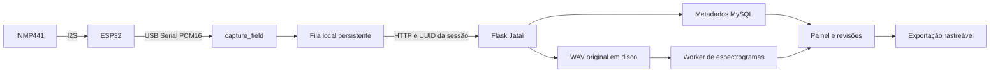
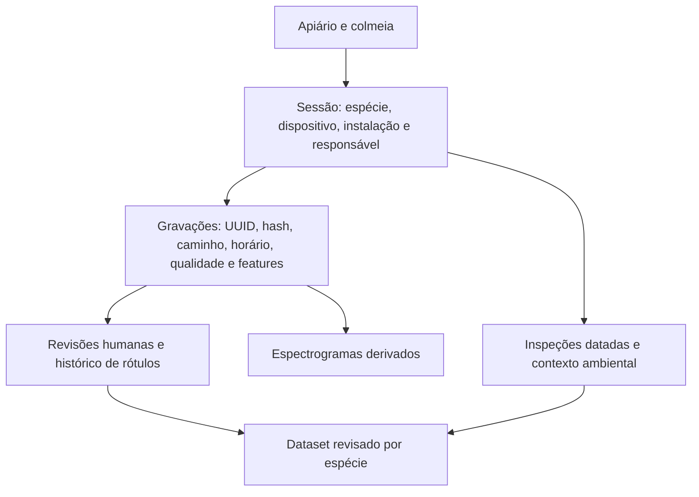
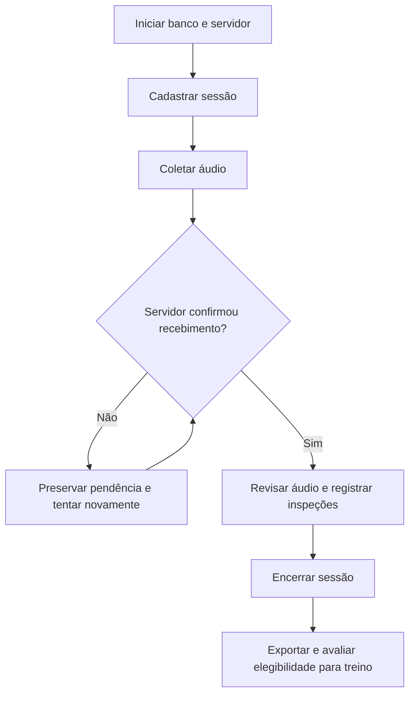

# BeeGuard — projeto, estrutura e fluxos

O BeeGuard registra sons de colmeias e permite relacioná-los a sessões de coleta, revisões humanas e inspeções. O foco operacional atual é a caixa de jataí, preservando a identidade da espécie e da colmeia. Temperatura e umidade são registros manuais.

## Organização

| Pasta | Conteúdo |
| --- | --- |
| `src/` | Servidores Flask, processamento acústico, exportação e ferramentas de IA |
| `src/acquisition/` | Protocolo serial, gravação local e espectrogramas offline |
| `web/templates/` | Telas HTML servidas pelo Flask |
| `firmware/BeeGuardAI/` | Sketch do ESP32 no formato esperado pelo Arduino IDE |
| `config/` | Configuração de exemplo e credenciais locais ignoradas pelo Git |
| `requirements/` | Dependências por etapa; requirements.txt da raiz reúne a aplicação |
| `tests/` | Testes de regressão existentes |
| `data/raw/urban/annotations/` | CSVs originais e proveniência da base UrBAN |
| `data/metadata/urban_inspections/` | Resumo e rótulos derivados das inspeções |
| `data/live/` | WAVs, filas e espectrogramas criados durante a operação |
| `data/processed/` | Datasets preparados e exportados |
| `models/` e `reports/` | Modelos experimentais e relatórios gerados |
| `docs/referencia/` | Guias detalhados preservados das entregas anteriores |

As pastas de saída são criadas conforme a execução. `run.py` seleciona um comando, configura a importação dos módulos de `src/` e usa a raiz do projeto como diretório de trabalho. Os servidores resolvem configuração, telas e armazenamento a partir da localização do código. Execute as ferramentas pelo lançador para manter os caminhos relativos consistentes.

## Componentes

`beeguard_server` recebe WAVs e persiste os metadados. `beeguard_monitor` acrescenta histórico e regras experimentais. `beeguard_field` acrescenta sessões, revisões e comparação. `beeguard_jatai` reúne essas camadas com espécies, inspeções e geração de PNG em segundo plano. Os módulos anteriores continuam sendo dependências do atual.

## Esquema conceitual dos dados

Este é um esquema conceitual; o SQL efetivo e as migrações estão nos métodos `init`, `init_monitor`, `init_field` e `init_jatai` dos módulos correspondentes. O banco armazena caminhos e metadados; os WAVs ficam em disco.

## Fluxo de operação

O áudio esperado é PCM16 mono a 16 kHz, em blocos de 10 segundos. Uma inspeção não rotula automaticamente todas as gravações próximas. A posição do microfone, ganho, ruído externo e horário afetam a comparação. Não há modelo validado de diagnóstico de saúde de jataí.

Veja [inicialização](../README.md), [IA](README_IA.md) e [manual completo](referencia/README.md).

## Verificação da reorganização — 30/10/2026

A suíte executada por run.py test encontrou 63 testes: 61 aprovados e dois ignorados pela ausência dos arquivos externos de auditoria e do manifesto de integração. Foram verificados endpoints e telas com repositórios em memória, filas HTTP locais, exportação e treinamento com dados de teste. A checagem das dependências não encontrou incompatibilidades declaradas. A conexão com o banco do XAMPP e a captura com ESP32 precisam ser verificadas no equipamento real.

